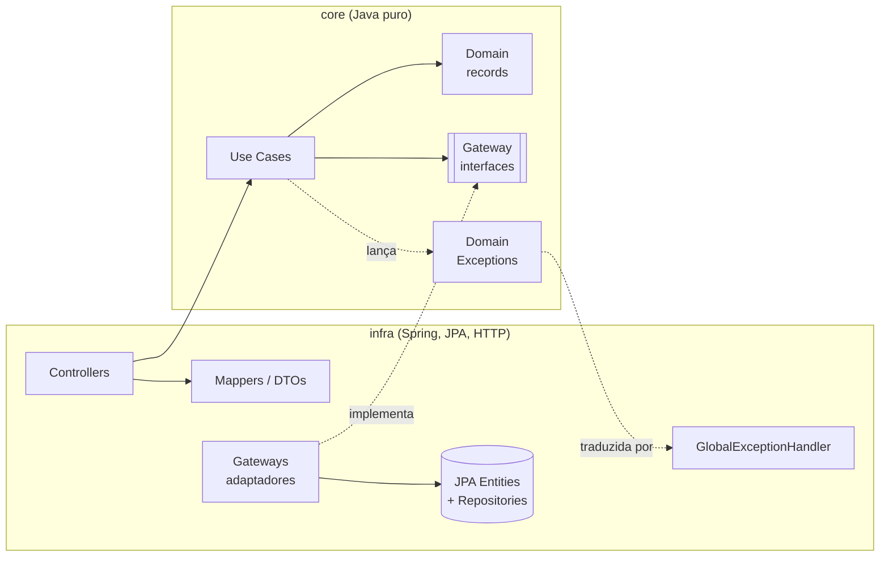

# RentHub API

API REST de reservas de imóveis por temporada, no estilo Airbnb: o anfitrião publica um imóvel, o hóspede escolhe as datas de check-in e check-out e faz a reserva.

O foco técnico do projeto é **garantir que não exista overbooking sob concorrência**: duas reservas simultâneas para o mesmo imóvel e período nunca podem ser confirmadas ao mesmo tempo.

> 🚧 **Projeto em desenvolvimento ativo.** Veja o [roadmap](#roadmap) para o que já está pronto e o que vem a seguir.

---

## Stack

| Camada | Tecnologia |
|---|---|
| Linguagem | Java 21 |
| Framework | Spring Boot 4.1 (Web MVC, Data JPA, Validation, Actuator) |
| Banco de dados | PostgreSQL 18 |
| Migrations | Flyway |
| Build | Maven (wrapper incluso) |
| Infra local | Docker Compose |

---

## Arquitetura

O projeto segue **Clean Architecture**, organizado como um **monólito modular** (um módulo por contexto: usuário, anúncio, reserva).



```
com.renthub.api
├── core/                      ← regras de negócio, sem nenhuma dependência de framework
│   ├── domain/<modulo>/       ← entidades de domínio (records)
│   ├── enums/
│   ├── exception/             ← exceções de domínio, organizadas por categoria
│   ├── gateway/<modulo>/      ← portas de saída (interfaces)
│   └── usecases/<modulo>/     ← casos de uso
└── infra/                     ← detalhes técnicos
    ├── beans/                 ← registro dos use cases como beans do Spring
    ├── dtos/                  ← contratos HTTP (Request / Response)
    ├── gateway/<modulo>/      ← adaptadores que implementam as portas
    ├── mapper/                ← conversão domínio ⇄ entidade JPA / DTO
    ├── persistence/<modulo>/  ← entidades JPA e repositórios Spring Data
    └── presentation/          ← controllers e tratamento global de erros
```

**Regras que a arquitetura garante:**

- O `core` não importa nada de Spring, JPA ou Jakarta: as regras de negócio são testáveis sem subir o framework.
- Use cases não têm `@Service` nem `@Transactional`; são registrados como beans na camada `infra`, e as transações ficam nos adaptadores.
- Um módulo não acessa a persistência de outro diretamente.

---

## Decisões técnicas

| Decisão | Motivo |
|---|---|
| IDs `UUID` | Não expõem volume de dados e permitem geração fora do banco. |
| Dinheiro em `BigDecimal` / `NUMERIC(10,2)` | `double` acumula erro de arredondamento. |
| Enums como `VARCHAR` + `CHECK` | Legível no banco e seguro contra reordenação (nunca `ORDINAL`). |
| Timestamps em `Instant` / `TIMESTAMPTZ` (UTC) | Um único referencial de tempo, independente do servidor ou do usuário. |
| Período da reserva `[check_in, check_out)` | Intervalo semiaberto: o dia do check-out fica livre para o próximo hóspede. |
| Preço da diária congelado na reserva | Alterar o preço do anúncio não muda reservas já feitas. |
| Schema só via Flyway (`ddl-auto: validate`) | O Hibernate valida o mapeamento, mas nunca altera o banco. |
| Erros no formato **Problem Details** (RFC 9457) | Formato padrão e previsível para quem consome a API. |

---

## Como rodar

**Pré-requisitos:** Java 21 e Docker.

**1. Configure as variáveis de ambiente**

```bash
cp .env.example .env
```

Edite o `.env` com o nome do banco, usuário e senha desejados.

**2. Suba o PostgreSQL**

```bash
docker compose up -d
```

O banco fica disponível na porta **5433** do host.

**3. Rode a aplicação**

```bash
./mvnw spring-boot:run
```

As migrations do Flyway são aplicadas automaticamente na inicialização.

**4. Verifique a saúde da aplicação**

```bash
curl http://localhost:8080/actuator/health
```

A resposta esperada é `"status": "UP"`, com o componente `db` também `UP`.

---

## Endpoints

| Método | Rota | Descrição |
|---|---|---|
| `POST` | `/api/v1/users` | Cria um usuário *(endpoint temporário de desenvolvimento; no produto final o usuário é criado no primeiro login com Google)* |
| `GET` | `/actuator/health` | Saúde da aplicação e do banco |

**Exemplo:**

```bash
curl -i -X POST http://localhost:8080/api/v1/users \
  -H "Content-Type: application/json" \
  -d '{"name":"Maria","email":"maria@exemplo.com","authProvider":"GOOGLE","providerId":"123"}'
```

### Formato dos erros

Todos os erros tratados seguem o padrão Problem Details:

```json
{
  "type": "about:blank",
  "title": "Bad Request",
  "status": 400,
  "detail": "Invalid request",
  "instance": "/api/v1/users",
  "errors": {
    "email": "must be a valid email"
  }
}
```

| Situação | Status |
|---|---|
| JSON malformado ou valor de enum inválido | `400` |
| Campo fora das regras de validação | `400` |
| Registro já existente (ex.: email em uso) | `409` |

---

## Roadmap

- [x] **Setup**: Spring Boot, PostgreSQL via Docker, Flyway, Actuator
- [x] **Usuário**: domínio, persistência, validação, regras de unicidade e tratamento de erros
- [ ] **Anúncios (Listing)**: cadastro com endereço e geolocalização, comodidades (N:N), CRUD
- [ ] **Testes**: unitários dos casos de uso (JUnit 5 + Mockito)
- [ ] **Autenticação**: login com Google (OAuth2)
- [ ] **Reservas**: criação de reserva sem overbooking sob concorrência (lock pessimista / constraint de exclusão com `daterange`), testada com Testcontainers
- [ ] **Escala horizontal**: várias instâncias atrás do Nginx
- [ ] **Réplica de leitura**: separação primário / réplica
- [ ] **Busca e cache**: upload de imagens no S3, busca e cache com Redis
- [ ] **Mensageria e observabilidade**: emails assíncronos com RabbitMQ, métricas e logs
- [ ] **Documentação interativa**: Swagger / OpenAPI
- [ ] **CI/CD**

---

## Autor

**Marcelo Henrique**: [GitHub](https://github.com/marcelosrg)
