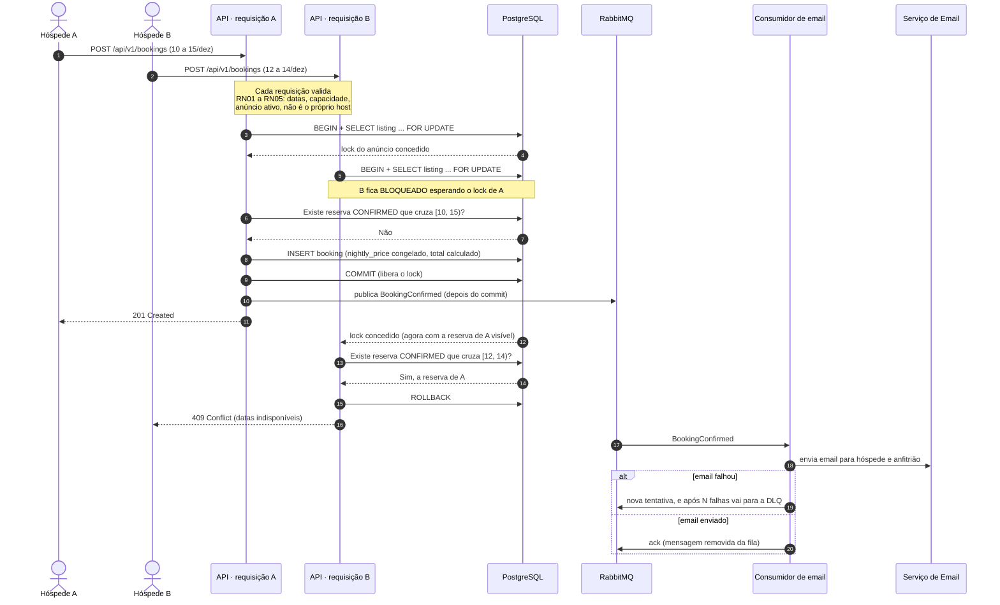

## tags: [renthub, system-design, concorrencia]

# RentHub — Diagrama de sequência: criar reserva

> Dois hóspedes tentam reservar o mesmo anúncio, com datas que se cruzam, **ao mesmo tempo**. Só um pode ganhar (RNF01).

## O que este diagrama mostra

- **Por que o caminho ingênuo quebra.** Sem o `FOR UPDATE` (passos 3 e 5), nada bloqueia: as perguntas dos passos 6 e 13 acontecem ao mesmo tempo, as duas ouvem "está livre" e as duas inserem. Resultado: overbooking. É a **race condition** do tipo _check-then-act_.
- **O lock serializa só quem disputa o mesmo anúncio.** Reservas de anúncios diferentes rodam em paralelo, sem esperar umas pelas outras.
- **O evento sai depois do commit.** Se fosse publicado antes e a transação falhasse, o hóspede receberia email de uma reserva que não existe.
- **O hóspede não espera o email.** A resposta 201 (passo 11) sai antes do email ser enviado (passo 18). Se o serviço de email cair, a reserva continua funcionando (RNF04, ADR-0005).
- **O conflito vira HTTP 409**, não 500. É uma regra de negócio esperada, não um erro do servidor.

## Ainda em aberto (ADR da F3)

Este diagrama usa **lock pessimista** (`SELECT ... FOR UPDATE` no anúncio). A alternativa é a **constraint de exclusão** do ERD: o fluxo é quase o mesmo, mas o passo 5 não bloqueia, e quem chega em segundo recebe um erro do próprio banco no `INSERT`, que a aplicação converte em 409.

Uma opção comum em produção é usar **as duas**: o lock dá a resposta limpa no caminho normal, e a constraint é a última linha de defesa se algum código futuro esquecer o lock.

## Conceitos

- **Race condition (check-then-act)** = verificar e agir em passos separados, deixando uma janela em que outro processo muda o estado no meio.
- **Lock pessimista** = "vou assumir que haverá conflito": trava o recurso antes de ler. `SELECT ... FOR UPDATE` no Postgres.
- **Lock otimista** = "vou assumir que não haverá conflito": não trava; detecta no fim por uma coluna `version` e falha se alguém mudou antes. Bom quando conflito é raro; ruim para disputa por datas populares.
- **Commit antes do evento** = nunca anunciar algo que ainda pode ser desfeito.
- **409 Conflict** = o pedido é válido, mas conflita com o estado atual do recurso.